# Siri Plus Launchpad

**English** | [Português](README.pt-BR.md)

A [Windhawk](https://windhawk.net) mod that replaces the Windows 11 Start menu with a macOS-inspired launcher: a Siri-style search bar with a categories menu, app tabs, file search, clipboard history, quick actions and live glass effects.

Press the **Windows key** (or click **Start**) and type, or pick what you want to search from the menu that drops down from the bar.

---

## Highlights

- **Four modes**: Original Siri (default), Floating, Window and Fullscreen
- **Live glass**: real-time blur behind the bar and panels (animated wallpapers and videos keep playing underneath), plus a liquid glass with refraction in the Siri modes
- **Search everything at once**: type in the bar and apps, actions, folders and files show up together in one list, like Spotlight or Flow Launcher, or pick a category (Apps, Files, Actions, Clipboard) to search only there
- **Calculator**: type a calculation and its result shows first; Enter copies it
- **Windows Settings**: type *display*, *startup apps*, *update*, *wi-fi*... and the matching Settings page opens
- **App tabs**: All, automatic categories and up to 6 tabs of your own
- **Recent apps row**: recently opened or installed apps (or the most used ones) on top
- **Power options**: type *shut down*, *restart*, *sleep*, *lock* or *sign out*, or the floating power button (off by default; turn it on in *Siri bar*)
- **Keyboard shortcuts**: Ctrl+1 … Ctrl+4 jump to Applications, Files, Actions and Clipboard, and can also open the launcher from any program (optional)
- **Custom icons**: give any app your own icon from a folder of your icons (such as a downloaded icon pack), with search and a color filter
- **Themes**: Clear glass, Custom liquid glass (your color at the top, fading to clear glass at the bottom), Light, Dark, OLED (deep black), Siri (macOS 27 gradient) and a fully Custom theme, with an optional glass effect on Light, Dark and OLED
- **Settings panel**: the **⋯** button at the end of the bar opens every setting in a macOS-style panel, applied live
- **Move the bar**: hold the Siri bar and drag it anywhere, on any monitor
- **Backup**: save settings, folders, tabs and custom icons to one file and restore them, even after reinstalling
- **Your language**: follows the Windows display language, or pick one (English, Portuguese, Spanish, French, German, Italian and Simplified Chinese)

---

## What's new in 1.2.0

- **Custom liquid glass theme**: your color (black to start with) solid at the top, thinning out smoothly into clear glass, with a fine line of light along the bottom edge. Its own settings: color strength at the top, how far down the color goes, the glass color, and the selection color in menus.
- **Stronger refraction**: above 60 % the liquid glass edge gets wider and deeper, like a thick lens. The default is now 70 %.
- **Liquid glass by default**: glass themes start with the Liquid glass style following the background live. Note that, while this is on, the launcher does not show in screenshots or recordings; turn *Liquid glass follows the background live* off to capture it, or pick *Light* in Performance on a slower PC.
- **New apps show up by themselves**: the app list follows installs and removals, from installers and from the Microsoft Store, without turning the mod off and on.
- **Keeps working right after a Windows update**: when Windhawk doesn't have the symbols for the new Windows files yet, the mod opens with the Windows key and the Start button in a temporary way instead of stopping (see *Compatibility*).

## What's new in 1.1.0

- **Windows Settings in the search**: about 60 Settings pages (Display, Startup apps, Personalization, Windows Update, Wi-Fi...) are found by name or by what you would type to look for them, and open with Enter.
- **Open file location**: right-click a file or folder found by the search to see it in File Explorer.
- **Two glass styles, clearly named**: *Translucent glass* (flat glass with a soft live blur, light on the PC) and *Liquid glass* (the background bends at the edges, like macOS 26; heavier on the PC). The setting's description changes with your choice.
- **Settings that don't apply are dimmed**: when a setting has no effect with your current choices (for example, the liquid glass options with a flat style, or the Files options with Files off), it turns gray, says why, and turns blue again when it can be used. Whole sections dim the same way (*Custom theme* until you pick the Custom theme).
- **A new settings panel and a new look in the screenshots**: both GIFs at the top and in *In action* were recorded again.

## Performance

- **Light mode works with any theme.** It is made so slower PCs can enjoy the mod smoothly: no liquid glass, no live blur, no blur behind menus, no shadows, at most 60 frames per second and calmer animations. With the Clear glass theme it draws an acrylic-style translucency instead of the live blur.
- **Translucent glass is light on the GPU**.
- **Hover and clicks answer right away**: clear glass areas used to let the mouse through, which made the settings button and the result rows feel slow or skip. Fixed.
- **Fewer repeated drawing calls**: the blur behind menus and the glass pieces are cached and rebuilt only when needed.
- **Nothing runs in the background** that you did not ask for: the diagnostic logging used while testing was removed.

---

## Screenshots

### Original Siri (default)
| Clear glass | Dark | OLED |
|---|---|---|
| 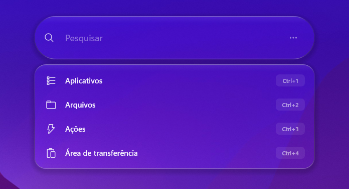 | 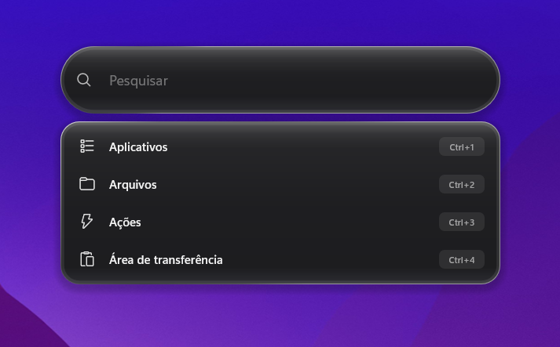 | 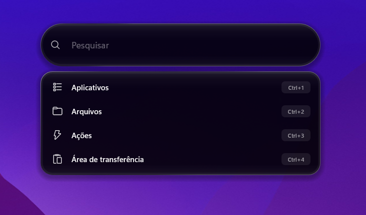 |

### Floating
| Clear glass | Light | Siri gradient |
|---|---|---|
| 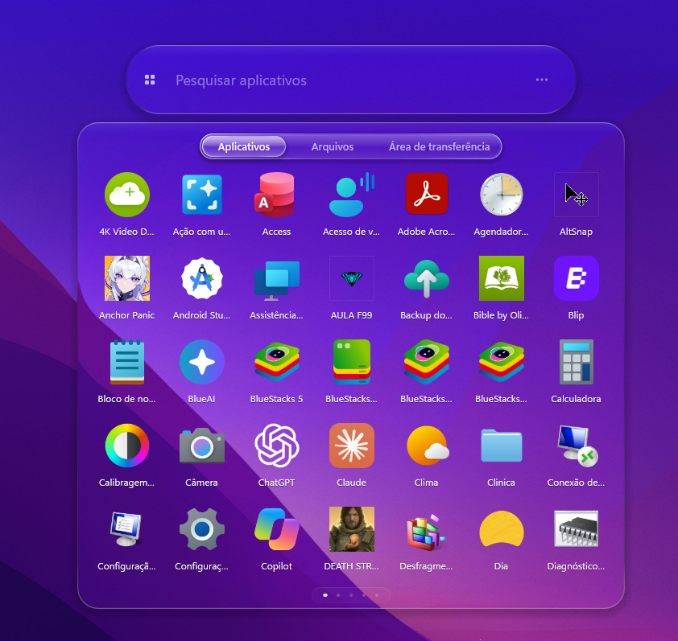 | 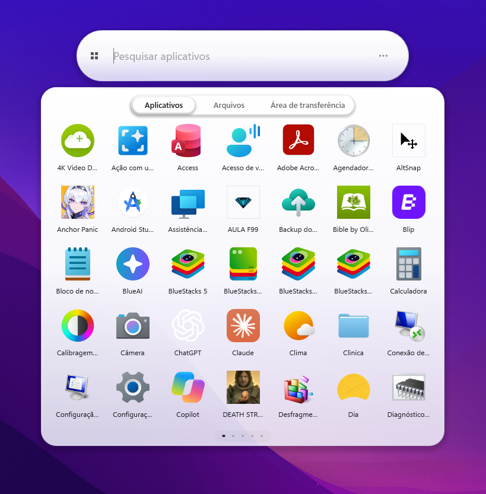 | 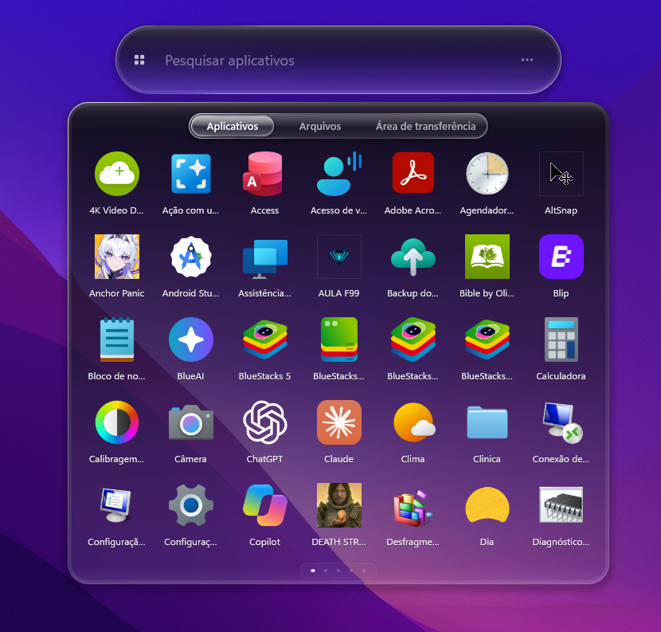 |

| Dark | OLED |
|---|---|
| 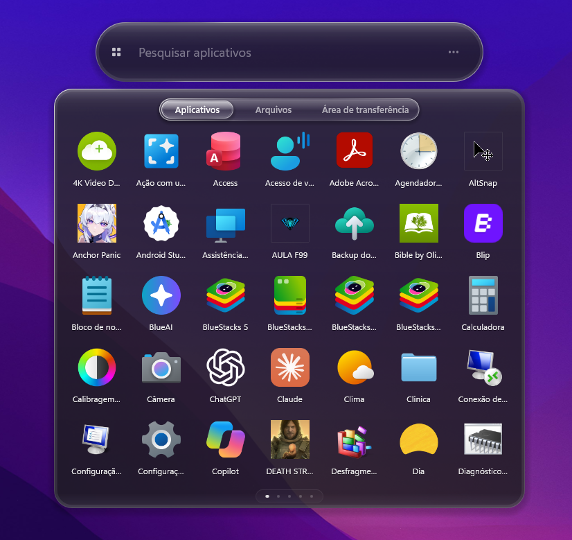 | 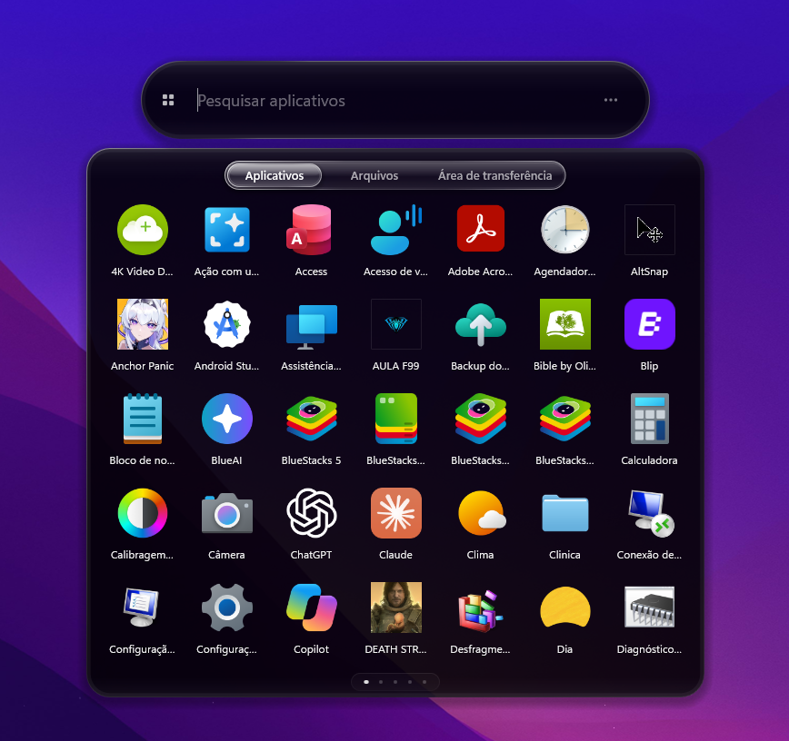 |

### Window
| Clear glass | Light | Siri gradient |
|---|---|---|
| 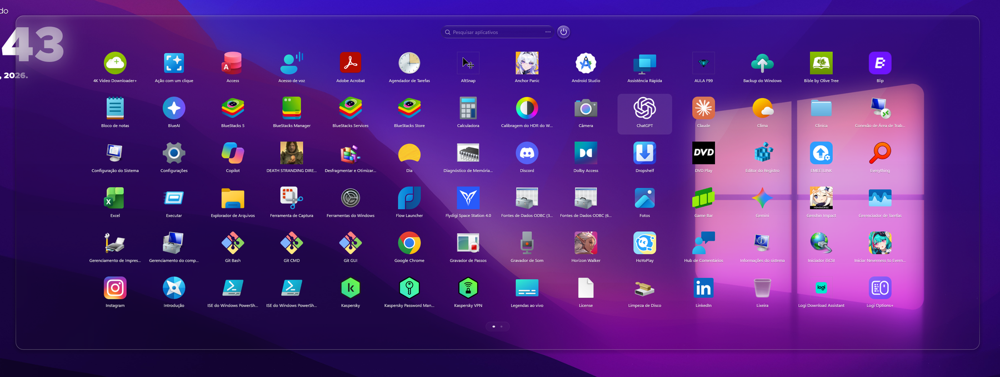 | 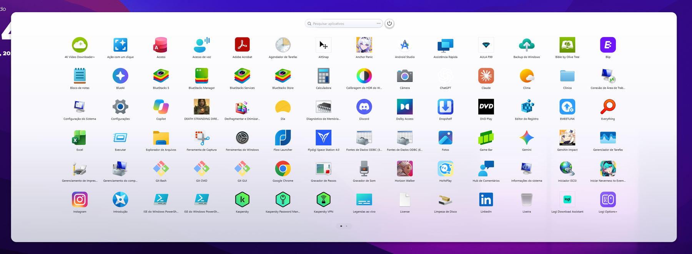 | 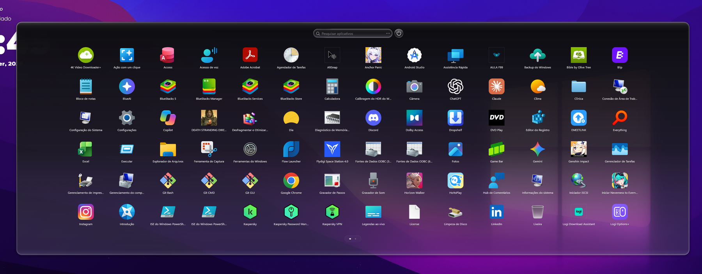 |

| Dark | OLED |
|---|---|
| 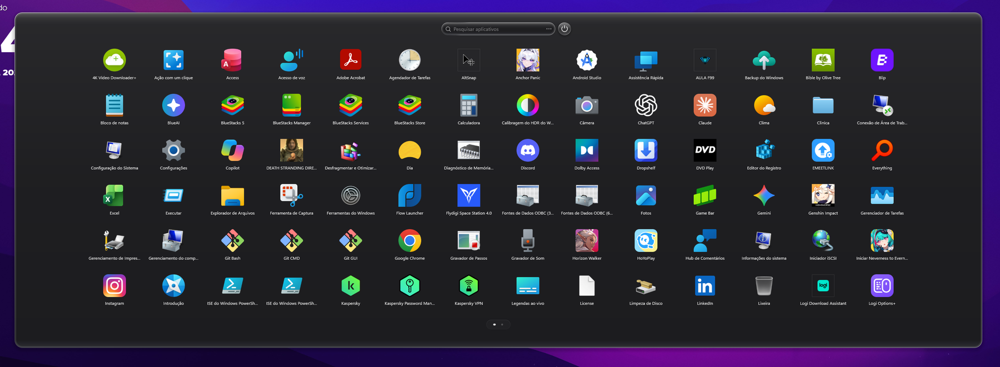 | 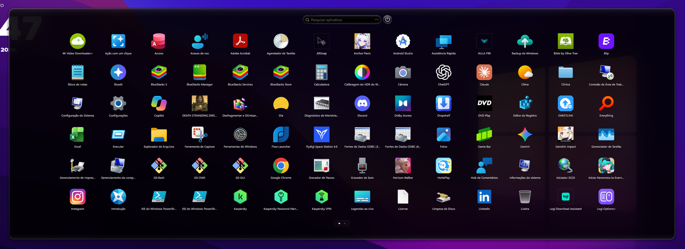 |

### Fullscreen
| Clear glass | Light | Siri gradient |
|---|---|---|
| 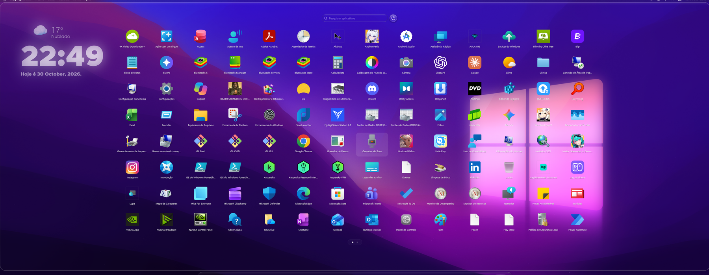 | 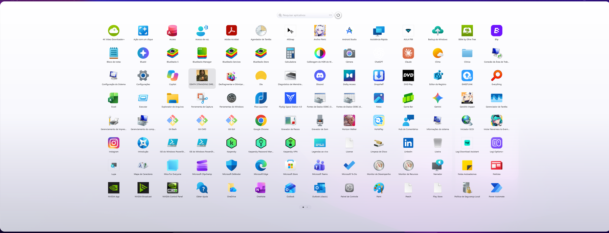 | 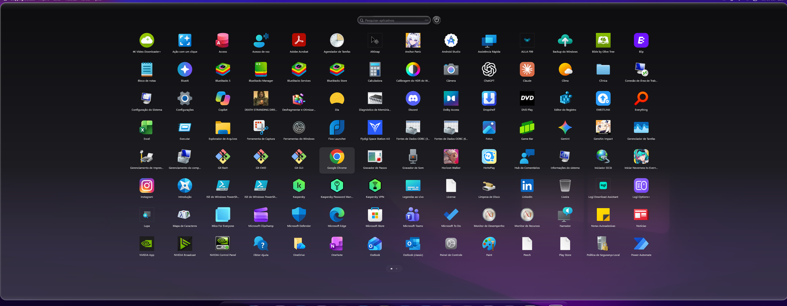 |

| Dark | OLED |
|---|---|
| 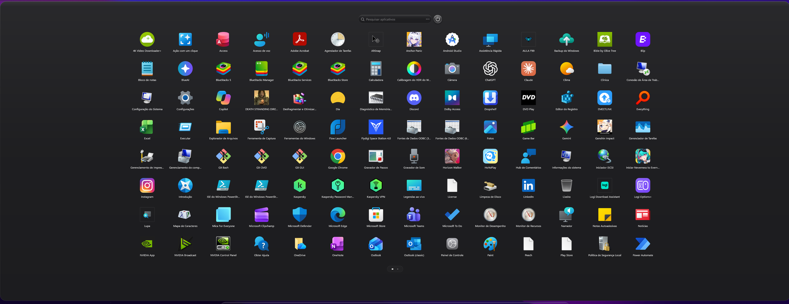 | 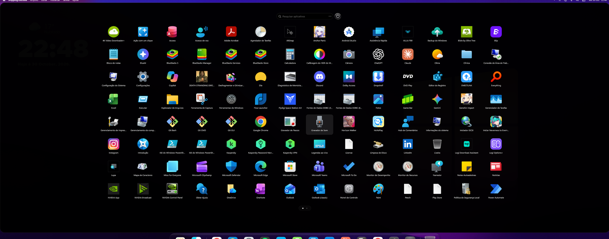 |

### In action
| Settings panel | Moving the bar |
|---|---|
|  | 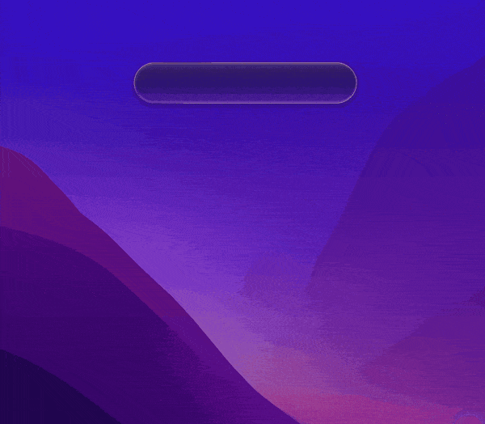 |

| Right-click menus and tabs | Power options |
|---|---|
| 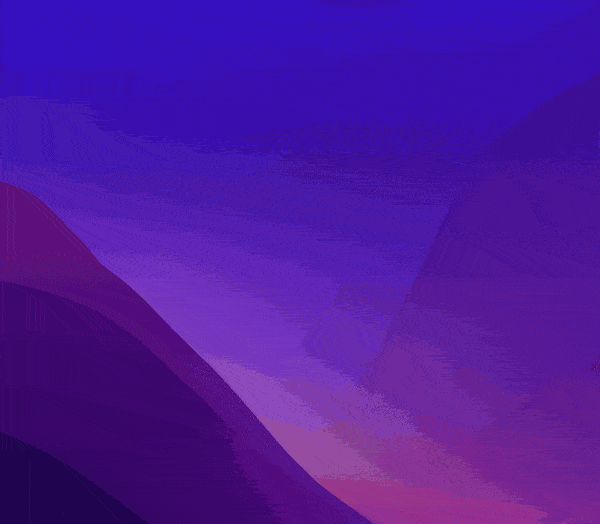 |  |

---

## Modes

### Original Siri (default)
A search bar in the macOS 27 style.

- **Categories menu**: hover over the bar (or click it) and a menu drops down with **Applications**, **Files**, **Actions** and **Clipboard**, each with its icon and its keyboard shortcut (default **Ctrl+1 … Ctrl+4**, configurable).
- **Search everything**: type straight away in "Search" and one list shows **Applications**, **Actions**, **Folders** and **Documents and files** together, each under its title (the best matches and the most used apps first). Apps show up at once; folders and files come in a moment later, below them, so nothing you are about to click moves. **Show all** next to a title opens that category with what you typed; **Enter** opens the first result. The clipboard is never part of it. Erasing the text brings back the plain "Search" bar. It can be turned off (*Siri bar → Typing in Search looks everywhere*): then typing goes to Applications.
- **Calculator**: type a calculation such as *2+2*, *15% * 80* or *(3+4)^2* and its result shows first, in a list; **Enter** copies it. Dates and phone numbers such as *2024-11-04* or *555-1234* are left alone (type *5 - 3* with spaces, or start with **=** or **calc**, as in *=5-3*, to always calculate), and the decimal mark follows Windows' region settings. It can be turned off (*Search → Calculator*).
- Picking a category makes its icon and name glide from the menu into the bar, and the search then works only inside that category.
- **Going back**: hover the category icon in the bar and it turns into a back arrow. Click it, or press **Esc**, to return to "Search" with the magnifier and pick another category.
- **App tabs**:
  - **All** comes first and shows every app.
  - Then the automatic categories: Utilities, Productivity, Entertainment, Social, Creativity, Reading and Other.
  - Then up to **6 tabs of your own**, for example "Games".
- **First row**: recently opened or installed apps, or the most used ones (configurable), separated from the rest by a thin line.
- **Actions**: Lock, Sleep, Restart, Shut down, Sign out, Settings, Task Manager, File Explorer, Control Panel, Screenshot and Empty Recycle Bin. Shut down works like Windows' own (fast startup when it is on) and warns before signing off other users who are still signed in.
- **Windows Settings**: in the general search, about 60 Settings pages (Display, Startup apps, Personalization, Windows Update, Wi-Fi, Bluetooth, Privacy, Accessibility...) are found by name or by what you would type to look for them (*screen*, *wallpaper*, *boot*...), in English or in Portuguese, and open with Enter. They show under their own title, up to 4 at a time, and follow the **Actions** tab being on.
- **Open file location**: right-click a file or folder found by the search and choose *Open file location* to see it in File Explorer, already selected.

### Floating
The bar appears out of an animated circle, the **Siri wave** or a soft glow, with zoom and an adjustable bounce. Clicking it or typing slides the results panel down. When it closes, the bar is "sucked" back into the bubble. Hover the category icon at the start of the bar and it turns into a back arrow, as in Original Siri: a click clears the search, goes back to Applications and closes the results panel.

### Window and Fullscreen
The classic Launchpad grid with pages or vertical scrolling, folders and a power button. Pages always slide inside the glass. Fullscreen respects the work area and the space reserved by docks.

---

## Managing app tabs (Original Siri)

| What | How |
|---|---|
| Create a tab | Right-click an app → **New tab with this app**, or right-click the tab strip / an empty area → **New tab**. Type the name and press **Enter** |
| Add apps | Inside a tab, right-click → **Add app**. A picker shows every app: **long-press** the first one, then a simple click selects or deselects the others (selected apps jiggle); **Done** saves |
| Remove an app | Inside a tab, right-click the app → **Remove from tab** |
| Rename or delete | Right-click the tab → **Rename tab** / **Delete tab** |
| Built-in tabs | They can also be edited (add or remove apps) and deleted. **Restore default tabs** brings them back |
| Move through tabs | **Tab / Shift+Tab**, or click and drag the strip sideways (the mouse wheel works too) |

---

## Files
- **Indexer**: Everything (through IPC, no DLL needed), Windows Search or a direct scan. The default, Automatic, uses the first one that is available.
- When the search is empty, your **recent searches** are shown, with a button to clear them. History can be turned off.
- Results show the **folder** of each file under its name, in a list or as icons.
- The maximum number of results is configurable.

## Clipboard
- Keeps the texts you copy while the mod runs (in memory only, never saved). The number of items and how long a copy stays (15 minutes to 7 days, or until Windows restarts) are configurable.
- The category only shows up when there is something in it. Each item has an **×** to remove it, and right-clicking gives **Clear clipboard**, which empties the history and the Windows clipboard.
- **Passwords stay out**: items that password managers and browsers mark as secret are skipped, just like Windows' own clipboard history (Win+V).
- Shown as a **list**: the first line of each text, with a preview of the rest (or its size) underneath.
- Click an item to copy it again. Turning the category off also stops monitoring and clears the history.

## Apps and icons
- **Search** apps by typing.
- **Folders** (Window and Fullscreen): drag apps together, rename, undo. The Siri modes list the apps of every folder together.
- **Multi-select** with jiggling icons, **pin to taskbar** (also by dragging an icon to the taskbar), **create desktop shortcut** (right-click an app; also for several selected apps at once), **uninstall**.
- **Custom icons**: put your icon images in a folder (for example a downloaded icon pack), then right-click an app → **Change icon...** The first time, the launcher asks for that folder (it can be changed later in *Apps and icons → Icon gallery folder*). The folder's images (PNG, JPG, JPEG, BMP, ICO, GIF or WebP, subfolders included) show in a grid; type to search them by name, or use the color dots to see only one color or put them in rainbow order. Images added to the folder show up the next time it opens. The new icon is remembered across restarts; **Reset icon** brings back the original. Works in every mode, including apps inside folders.
- Icon size, number of columns and the scrolling direction are configurable.

## Settings panel
- Click the **⋯** button at the end of the bar (every mode). A window in the style of macOS System Settings grows out of the bar: the sections on the left, with a search field on top, and the settings of the chosen section on the right. Every change applies at once.
- Sections: **General**, **Appearance**, **Custom theme**, **Search** (search everything, Files and Clipboard), **Siri bar**, **Results size**, **Window and Fullscreen**, **Animations**, **Keyboard shortcuts**, **Apps and icons**, **Performance** and **Backup and defaults**. Every setting has a short line saying what it does, and the ones that don't apply to what you chose (the mode, the theme, the glass style or a switch they depend on) are dimmed, say why and can't be changed until they do.
- Changes made there are kept on top of Windhawk's settings, and a change made later in Windhawk wins again.
- **Theme defaults** (Appearance) brings back the chosen theme's own look. **Restore all defaults** puts every setting back to how the mod comes and the bar back in the center; folders, tabs and custom icons stay.
- **Back up** saves everything to a `.siribackup` file: every setting (the icon gallery folder too), folders, tabs, search history, the bar's place and the custom icons, with their pictures inside the file. **Restore a backup** brings it all back, also after uninstalling the mod (which erases its stored data) or on another PC.
- **Done** (or **Esc**) closes it: the window switches off where it is, like an old TV (CRT), and the launcher closes; a new mode or bar size shows the next time it opens. In Light performance mode the window opens without its content coming in one piece at a time.

## Moving the bar (Floating and Original Siri)
- Hold the bar for a moment and drag it anywhere, on any monitor. Its place is remembered. Low on the screen, the results and menus open above it.
- Right-click the bar → **Put the bar back in the center** (shown once it has been moved).

---

## Customization

All options are in the **⋯** settings panel (in seven languages) and in the mod's **Settings** tab in Windhawk (English and Portuguese).

| Block | Options |
|---|---|
| ① Mode | Original Siri (default), Floating, Window, Fullscreen |
| ② Theme | Clear glass, Custom liquid glass, Light, Dark, OLED, Siri (macOS 27 gradient), Custom |
| Language | Automatic (Windows) or English, Português, Español, Français, Deutsch, Italiano, 中文（简体） |
| Performance | **Light (faster)** works with any theme and is made so slower PCs can enjoy the mod smoothly: it turns off liquid glass, the live blur, the blur behind menus and the shadows, keeps it to 60 frames per second and calms the animations; a frame rate limit (automatic, 120, 60 or 30); and *Draw with*: the graphics card (default) or the processor (experimental, for laptops with two graphics cards) |
| ③ Appearance | Theme defaults button, glass transparency (each theme keeps its own; Light and OLED start solid), corner rounding, background blur (0 = no blur), blur behind right-click menus, text color (automatic: on clear glass, black over light backgrounds; or white or black), glass style (translucent glass with a live blur, or liquid glass for Floating and Original Siri, with its refraction strength and an optional live mode), glass effect on Light/Dark/OLED |
| ④ Custom theme | Color, opacity, dark-to-light gradient, border width, color and opacity |
| ⑤ Window and Fullscreen | Window size, search style (top bar or centered box), power button and its position, opening and closing animations (pop, fade, rise from/sink into the taskbar, CRT), animation speed, blur behind open folders |
| ⑥ Floating and Original Siri | Bar size (96 px tall by default), results box width and rows for each category (Files and Clipboard as wide as the bar by default), circle animation (Siri wave, soft glow, none), circle zoom, bounce of the circle and of the results box, opening/closing duration, animation speed, search everything when typing, power options when typing, floating power button (off by default) and its side (left or right of the bar), first row (recent, most used, off), Original Siri category shortcuts for Applications, Files, Actions and Clipboard (defaults **Ctrl+1**, **Ctrl+2**, **Ctrl+3**, **Ctrl+4**; any combination starting with Ctrl, e.g. Ctrl+Shift+F or Ctrl+F2), and whether they also work with the launcher closed (off by default) |
| ⑦ Opening | Open with the Windows key and/or the Start button |
| ⑧ Apps and icons | Icon size, columns, scrolling direction, jiggle, drag to the taskbar to pin, icon gallery folder |
| ⑨ Files | On/off, search history, list or icons, indexer, maximum results |
| ⑩ Clipboard | On/off, number of items kept, how long a copy stays |

---

## Keyboard and mouse

| Key / action | What it does |
|---|---|
| **Win** / Start button | Open or close |
| Type | Search (in Original Siri, typing right away searches apps, actions, folders and files together) |
| **Ctrl+1 / 2 / 3 / 4** | Original Siri: go to Applications / Files / Actions / Clipboard (configurable). With *Also with the launcher closed* on (off by default) they open the launcher from any program, and other programs no longer get those keys |
| **Tab / Shift+Tab** | Original Siri: next/previous app tab, or move through the results in Files, Clipboard and Actions |
| Arrows + **Enter** | Move through results / open |
| Other **Ctrl+digits** | Launch the matching result (never an action such as Shut down) |
| **Esc** | Closes menus, then clears the search, goes back to the categories and finally closes |
| Right-click on the search bar | Cut, Copy, Paste, Select all, Delete all |
| Long-press an app | Select it; then a simple click selects or deselects more apps (Window/Fullscreen: right-click → **New folder with N items** puts them in a folder; Original Siri: inside the app picker) |

---

## Requirements
- Windows 11 (x64)
- [Windhawk](https://windhawk.net)
- Live blur needs **Transparency effects** turned on in Windows (*Settings → Personalization → Colors*). Without it, a blurred still image is used.
- Optional: [Everything](https://www.voidtools.com) for instant file search (run it normally, not as administrator)

## Privacy and files
- The mod never goes online.
- Its own files (icons restored from a backup, the colors found for the gallery's images) are kept in the mod's storage folder, which Windhawk removes together with the mod. The gallery's images are only read from the folder you choose; backups are written only where you choose. **Create desktop shortcut** adds a shortcut to your desktop only when you pick it, and never replaces a file already there.
- The clipboard history lives in memory only and is never written to disk.

## Compatibility
- **Right after a Windows update**: Windhawk may not have the symbols for the new Windows files yet, and the mod can't place its Start hook. It keeps working in a temporary way until they arrive: the Windows key and clicks on the Start button are caught directly and open the launcher as always; only Ctrl+Esc or a touch on the Start button shows Windows' own Start menu for a moment before the launcher takes its place. Nothing needs to be done; the normal way comes back by itself the next time the mod loads with the symbols available.
- **Category shortcuts from any program** (off by default): when *Shortcuts → Also with the launcher closed* is on, Ctrl+1 … Ctrl+4 are registered as system hotkeys, so other programs no longer get them (for example, the browser's Ctrl+1 for the first tab). Leave it off, or pick other combinations, if you need those keys elsewhere.
- **Fullscreen Start** (`fullscreen-start`): don't enable both. Each one replaces the Start menu through the same hook without calling the original, so only one of them would get the Windows key.
- **Spotlight Launcher**: it adds a separate search bar on Alt+Space and leaves the Start menu alone. This mod replaces the Start menu itself (Windows key and Start button) and adds app tabs, folders, files, clipboard history and actions. Both can be used together.

---

## Support the project
If you enjoy Siri Plus Launchpad, you can support its development with a Pix donation:

**[Donate with LivePix (Pix)](https://livepix.gg/kurokobr)**

---

## Author
Developed and maintained by **Thiago Silva** ([github.com/brideinflame-rgb](https://github.com/brideinflame-rgb)).

## License
Copyright (c) 2026 Thiago Silva. Licensed under the **GNU General Public License v3.0**.
