# Siri Plus Launchpad

A [Windhawk](https://windhawk.net) mod that replaces the Windows 11 Start menu with a macOS-inspired launcher: a Siri-style search bar with a categories menu, app tabs, file search, clipboard history, quick actions and live glass effects.

Press the **Windows key** (or click **Start**) and type, or pick what you want to search from the menu that drops down from the bar.

---

## Highlights

- **Four modes**: Original Siri (default), Floating, Window and Fullscreen
- **Live glass**: real-time blur behind the bar and panels (animated wallpapers and videos keep playing underneath), plus an experimental liquid glass with refraction in the Siri modes
- **One search for everything**: Apps, Files, Clipboard and Actions
- **App tabs**: All, automatic categories and up to 6 tabs of your own
- **Recent apps row**: recently opened or installed apps (or the most used ones) on top
- **Power options**: type *shut down*, *restart*, *sleep*, *lock* or *sign out*, or use the floating power button
- **Keyboard shortcuts**: Ctrl+1 … Ctrl+4 jump to Applications, Files, Actions and Clipboard, also with the launcher closed (configurable)
- **Custom icons**: give any app your own icon (PNG, JPG, ICO, WebP...), or pick one from a **GitHub repository** of icons, with search and a color filter
- **Themes**: Clear glass, Light, Dark, OLED (deep black), Siri (macOS 27 gradient) and a fully Custom theme, with an optional glass effect on Light, Dark and OLED
- **Settings panel**: the **⋯** button at the end of the bar opens every setting in a macOS-style panel, applied live
- **Move the bar**: hold the Siri bar and drag it anywhere, on any monitor
- **Backup**: save settings, folders, tabs and custom icons to one file and restore them, even after reinstalling
- **Your language**: follows the Windows display language, or pick one (English, Portuguese, Spanish, French, German and Italian)

---

## Screenshots

### Original Siri (default)
| Clear glass | Dark | OLED |
|---|---|---|
| 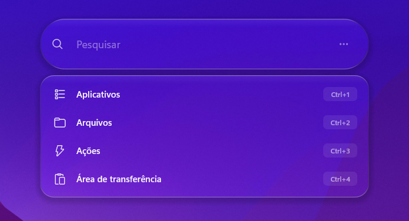 | 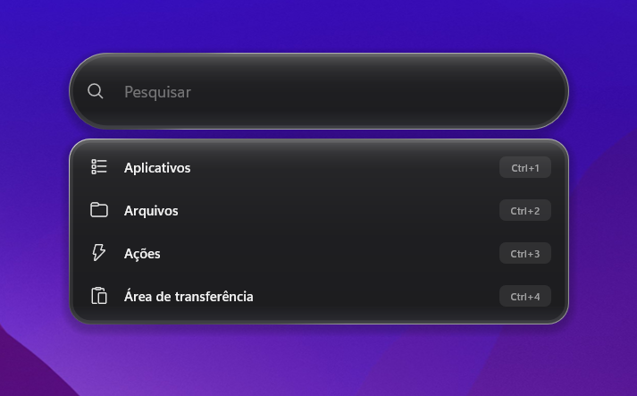 | 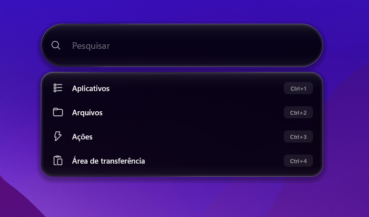 |

### Floating
| Clear glass | Light | Siri gradient |
|---|---|---|
| 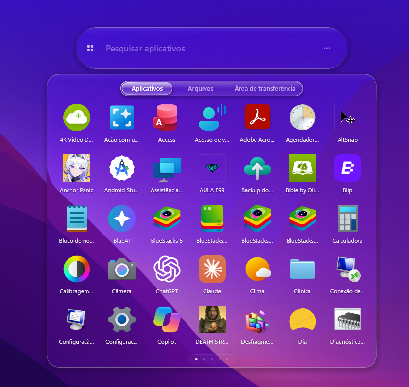 | 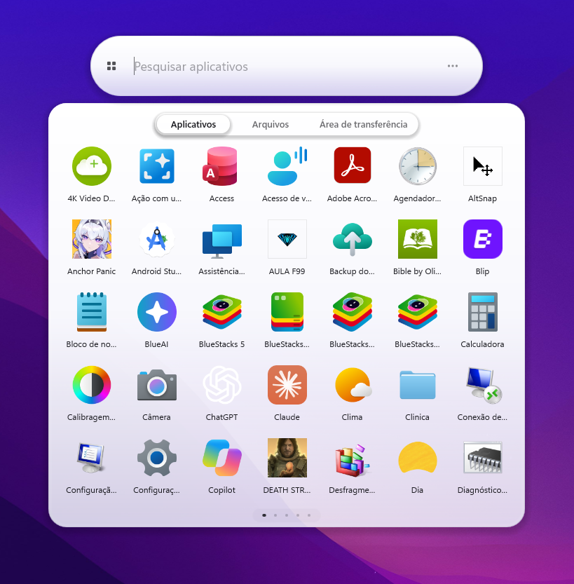 | 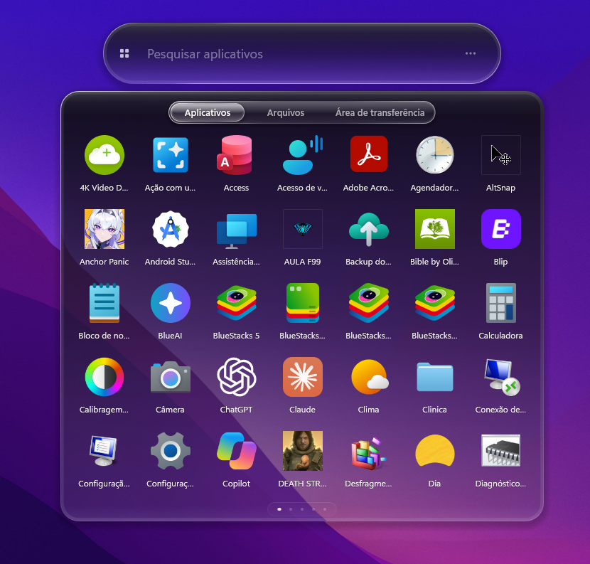 |

| Dark | OLED |
|---|---|
| 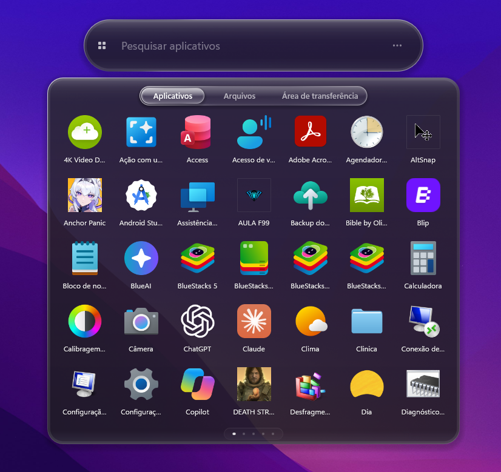 | 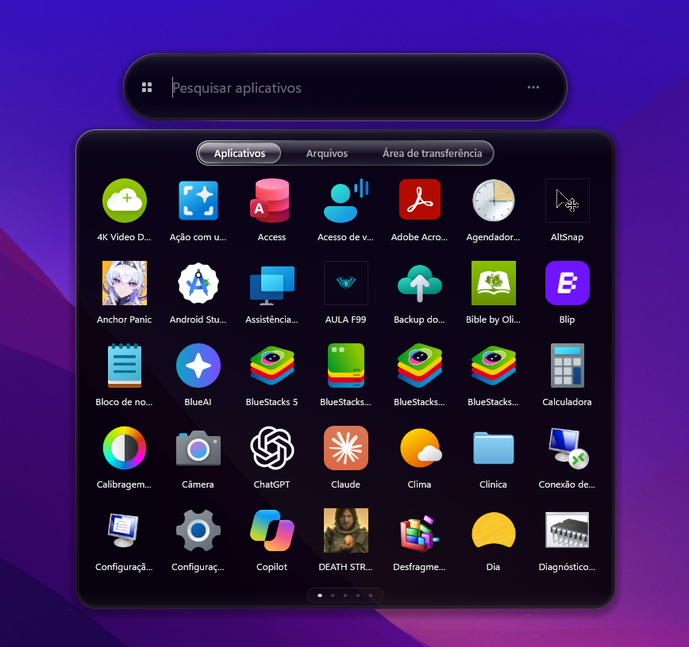 |

### Window
| Clear glass | Light | Siri gradient |
|---|---|---|
| 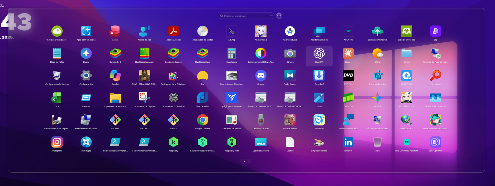 | 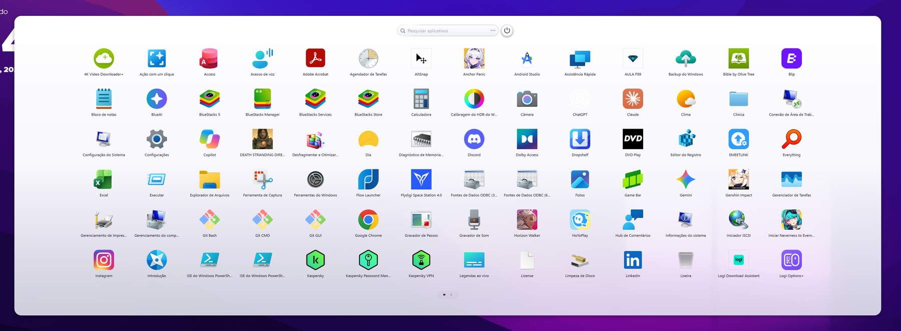 | 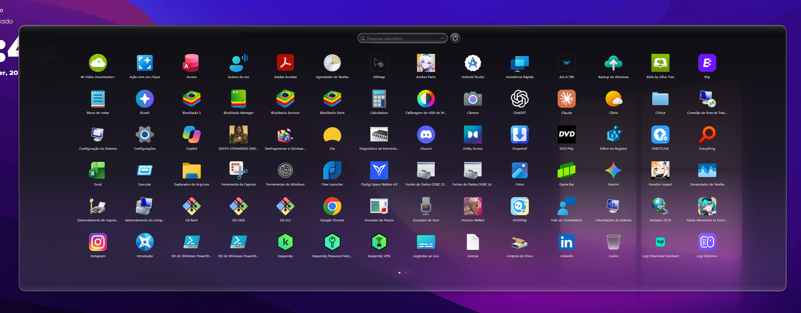 |

| Dark | OLED |
|---|---|
| 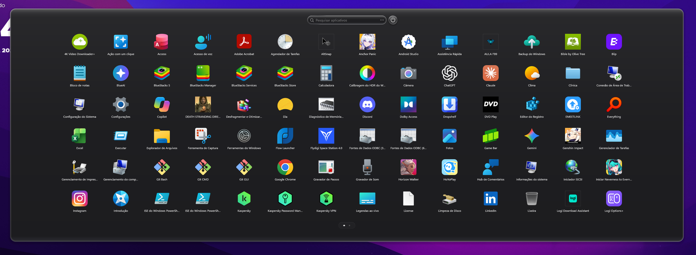 | 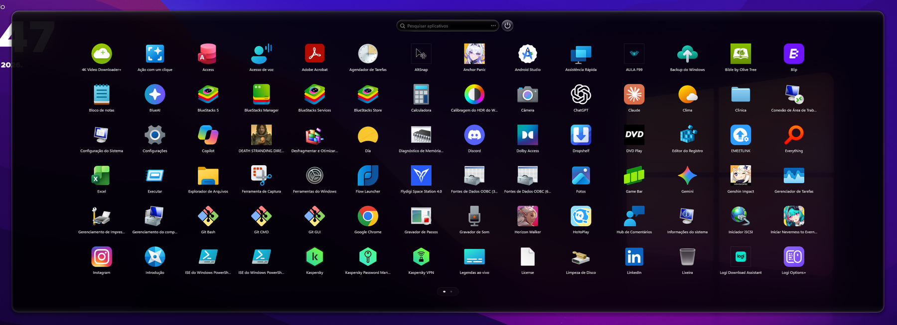 |

### Fullscreen
| Clear glass | Light | Siri gradient |
|---|---|---|
| 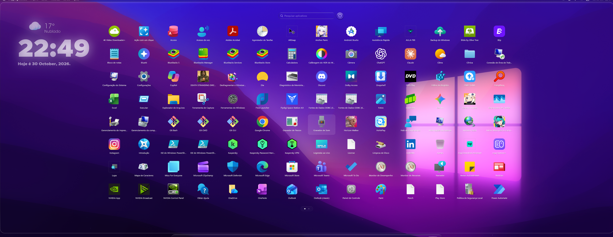 | 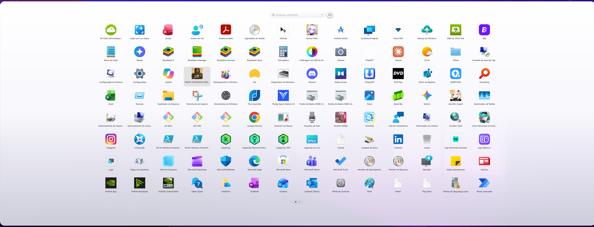 | 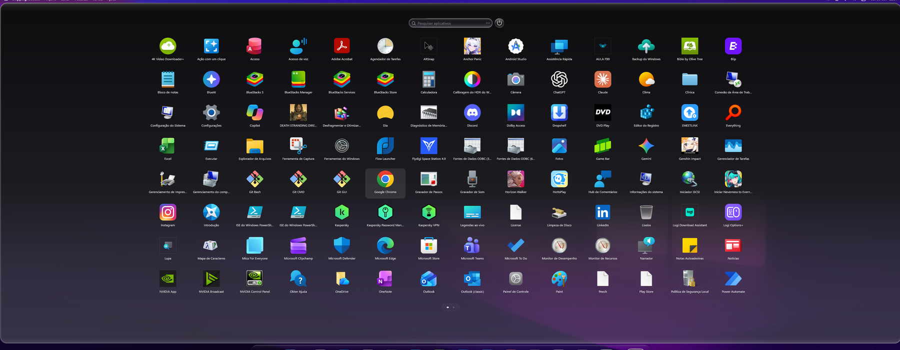 |

| Dark | OLED |
|---|---|
| 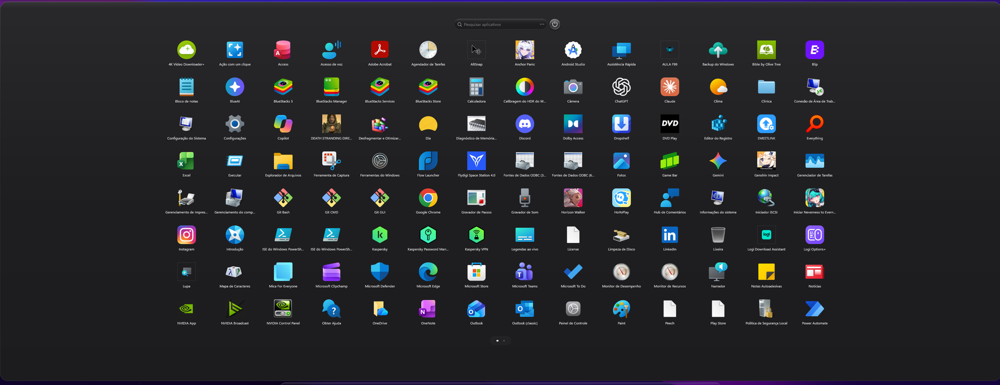 | 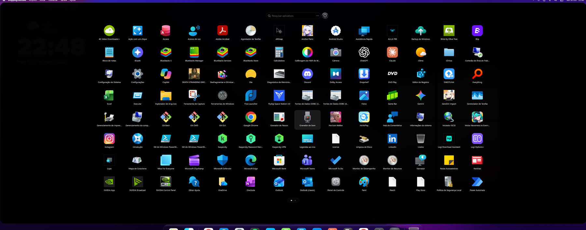 |

### In action
| Settings panel | Moving the bar |
|---|---|
|  | 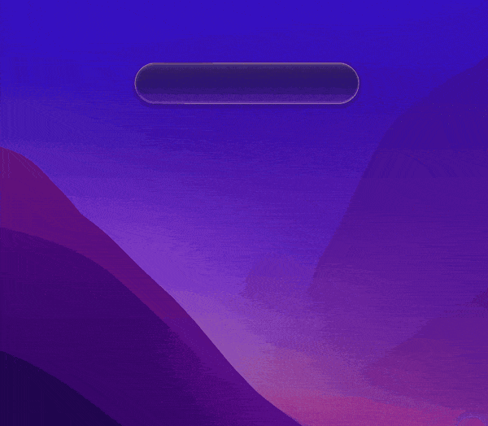 |

| Right-click menus and tabs | Power options |
|---|---|
| 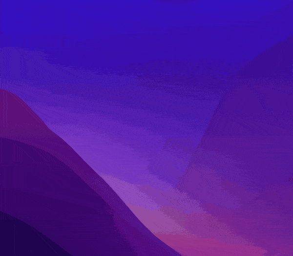 |  |

---

## Modes

### Original Siri (default)
A search bar in the macOS 27 style.

- **Categories menu**: hover over the bar (or click it) and a menu drops down with **Applications**, **Files**, **Actions** and **Clipboard**, each with its icon and its keyboard shortcut (default **Ctrl+1 … Ctrl+4**, configurable).
- Picking a category makes its icon and name glide from the menu into the bar, and the search then works inside that category. If you type straight away, you go to Applications.
- **Going back**: hover the category icon in the bar and it turns into a back arrow. Click it, or press **Esc**, to return to "Search" with the magnifier and pick another category.
- **App tabs**:
  - **All** comes first and shows every app.
  - Then the automatic categories: Utilities, Productivity, Entertainment, Social, Creativity, Reading and Other.
  - Then up to **6 tabs of your own**, for example "Games".
- **First row**: recently opened or installed apps, or the most used ones (configurable), separated from the rest by a thin line.
- **Actions**: Lock, Sleep, Restart, Shut down, Sign out, Settings, Task Manager, File Explorer, Control Panel, Screenshot and Empty Recycle Bin. Shut down works like Windows' own (fast startup when it is on) and warns before signing off other users who are still signed in.

### Floating
The bar appears out of an animated circle, the **Siri wave** or a soft glow, with zoom and an adjustable bounce. Clicking it or typing slides the results panel down. When it closes, the bar is "sucked" back into the bubble.

### Window and Fullscreen
The classic Launchpad grid with pages or vertical scrolling, folders and a power button. Pages always slide inside the glass. Fullscreen respects the work area and the space reserved by docks.

---

## Managing app tabs (Original Siri)

| What | How |
|---|---|
| Create a tab | Right-click an app → **New tab with this app**, or right-click the tab strip / an empty area → **New tab**. Type the name and press **Enter** |
| Add apps | Inside a tab, right-click → **Add app**. A picker shows every app: **long-press** the first one, then a simple click selects or deselects the others (selected apps jiggle); **Done** saves |
| Remove an app | Inside a tab, right-click the app → **Remove from tab** |
| Rename or delete | Right-click the tab → **Rename tab** / **Delete tab** |
| Built-in tabs | They can also be edited (add or remove apps) and deleted. **Restore default tabs** brings them back |
| Move through tabs | **Tab / Shift+Tab**, or click and drag the strip sideways (the mouse wheel works too) |

---

## Files
- **Indexer**: Everything (through IPC, no DLL needed), Windows Search or a direct scan. The default, Automatic, uses the first one that is available.
- When the search is empty, your **recent searches** are shown, with a button to clear them. History can be turned off.
- Results show the **folder** of each file under its name, in a list or as icons.
- The maximum number of results is configurable.

## Clipboard
- Keeps the texts you copy while the mod runs (in memory only, never saved). The number of items and how long a copy stays (15 minutes to 7 days, or until Windows restarts) are configurable.
- The category only shows up when there is something in it. Each item has an **×** to remove it, and right-clicking gives **Clear clipboard**, which empties the history and the Windows clipboard.
- **Passwords stay out**: items that password managers and browsers mark as secret are skipped, just like Windows' own clipboard history (Win+V).
- Shown as a **list**: the first line of each text, with a preview of the rest (or its size) underneath.
- Click an item to copy it again. Turning the category off also stops monitoring and clears the history.

## Apps and icons
- **Search** apps by typing.
- **Folders** (Window and Fullscreen): drag apps together, rename, undo. The Siri modes list the apps of every folder together.
- **Multi-select** with jiggling icons, **pin to taskbar** (also by dragging an icon to the taskbar), **uninstall**.
- **Custom icons**: right-click an app → **Change icon...** and pick an image (PNG, JPG, JPEG, BMP, ICO, GIF or WebP). The new icon is remembered across restarts; **Reset icon** brings back the original. Works in every mode, including apps inside folders.
- **Icons from GitHub**: set a repository in the settings (`owner/repository`, or a link to it or to a folder in it), then right-click an app → **Icon from GitHub...** The repository's images show in the grid; type to search them by name, or use the color dots to see only one color or put them in rainbow order. Pictures added or replaced in the repository show up the next time the gallery opens. After picking, the launcher goes back to where it was, with that app selected.
- Icon size, number of columns and the scrolling direction are configurable.

## Settings panel
- Click the **⋯** button at the end of the bar (every mode). The bar moves to the left and becomes a list of sections, and a panel with the settings comes out of the button. Every change applies at once.
- Changes made there are kept on top of Windhawk's settings, and a change made later in Windhawk wins again.
- **Theme defaults** (Appearance) brings back the chosen theme's own look. **Restore all defaults** (General) puts every setting back to how the mod comes and the bar back in the center; folders, tabs and custom icons stay.
- **Back up** saves everything to a `.siribackup` file: every setting (the GitHub repository too), folders, tabs, search history, the bar's place and the custom icons, with their pictures inside the file. **Restore a backup** brings it all back, also after uninstalling the mod (which erases its stored data) or on another PC.
- In Window and Fullscreen the window folds into its search field while the settings are open. With the bar low on the screen, the settings open upward.

## Moving the bar (Floating and Original Siri)
- Hold the bar for a moment and drag it anywhere, on any monitor. Its place is remembered. Low on the screen, the results and menus open above it.
- Right-click the bar → **Put the bar back in the center** (shown once it has been moved).

---

## Customization

All options are in the **⋯** settings panel (in six languages) and in the mod's **Settings** tab in Windhawk (English and Portuguese).

| Block | Options |
|---|---|
| ① Mode | Original Siri (default), Floating, Window, Fullscreen |
| ② Theme | Clear glass, Light, Dark, OLED, Siri (macOS 27 gradient), Custom |
| Language | Automatic (Windows) or English, Português, Español, Français, Deutsch, Italiano |
| ③ Appearance | Theme defaults button, glass transparency (each theme keeps its own; Light and OLED start solid), corner rounding, background blur (0 = no blur), blur behind right-click menus, text color (automatic: on clear glass, black over light backgrounds; or white or black), clear glass style (frosted, or experimental liquid for Floating and Original Siri, with its refraction strength and an optional live mode), glass effect on Light/Dark/OLED |
| ④ Custom theme | Color, opacity, dark-to-light gradient, border width, color and opacity |
| ⑤ Window and Fullscreen | Window size, search style (top bar or centered box), power button and its position, opening and closing animations (pop, fade, rise from/sink into the taskbar, CRT), animation speed, blur behind open folders |
| ⑥ Floating and Original Siri | Bar size, results box width and rows for each category (Files and Clipboard as wide as the bar by default), circle animation (Siri wave, soft glow, none), circle zoom, bounce of the circle and of the results box, opening/closing duration, animation speed, power options when typing, floating power button, first row (recent, most used, off), Original Siri category shortcuts for Applications, Files, Actions and Clipboard (defaults **Ctrl+1**, **Ctrl+2**, **Ctrl+3**, **Ctrl+4**; any combination starting with Ctrl, e.g. Ctrl+Shift+F or Ctrl+F2), and whether they also work with the launcher closed |
| ⑦ Opening | Open with the Windows key and/or the Start button |
| ⑧ Apps and icons | Icon size, columns, scrolling direction, jiggle, drag to the taskbar to pin, GitHub icon repository |
| ⑨ Files | On/off, search history, list or icons, indexer, maximum results |
| ⑩ Clipboard | On/off, number of items kept, how long a copy stays |

---

## Keyboard and mouse

| Key / action | What it does |
|---|---|
| **Win** / Start button | Open or close |
| Type | Search (in Original Siri, typing right away searches Applications) |
| **Ctrl+1 / 2 / 3 / 4** | Original Siri: go to Applications / Files / Actions / Clipboard (configurable). By default they also open the launcher from any program; turn that off if you need these keys elsewhere (e.g. browser tabs) |
| **Tab / Shift+Tab** | Original Siri: next/previous app tab, or move through the results in Files, Clipboard and Actions |
| Arrows + **Enter** | Move through results / open |
| Other **Ctrl+digits** | Launch the matching result (never an action such as Shut down) |
| **Esc** | Closes menus, then clears the search, goes back to the categories and finally closes |
| Right-click on the search bar | Cut, Copy, Paste, Select all, Delete all |
| Long-press an app | Select it; then a simple click selects or deselects more apps (Window/Fullscreen: right-click → **New folder with N items** puts them in a folder; Original Siri: inside the app picker) |

---

## Requirements
- Windows 11 (x64)
- [Windhawk](https://windhawk.net)
- Live blur needs **Transparency effects** turned on in Windows (*Settings → Personalization → Colors*). Without it, a blurred still image is used.
- Optional: [Everything](https://www.voidtools.com) for instant file search (run it normally, not as administrator)

## Privacy, network and files
- **Network**: the mod only goes online for **Icons from GitHub**, and only after you set a repository: it reads the repository's file list from `api.github.com` and downloads images from `raw.githubusercontent.com`. Nothing about you or your PC is sent.
- **Files it writes**: downloaded GitHub images (and the colors found for them) are cached in `%LOCALAPPDATA%\SiriPlusLaunchpad\GitHubIcons`; icons restored from a backup go to `%LOCALAPPDATA%\SiriPlusLaunchpad\Icons`. These folders stay after uninstalling and can be deleted by hand. Backups are written only where you choose.
- The clipboard history lives in memory only and is never written to disk.

## Compatibility
- **Ctrl+1 … Ctrl+4 everywhere** (on by default): while this is on, other programs no longer get these keys (for example, the browser's Ctrl+1 for the first tab). Turn it off in *Shortcuts*, or pick other combinations.
- **Fullscreen Start** (`fullscreen-start`): don't enable both. Each one replaces the Start menu through the same hook without calling the original, so only one of them would get the Windows key.
- **Spotlight Launcher**: it adds a separate search bar on Alt+Space and leaves the Start menu alone. This mod replaces the Start menu itself (Windows key and Start button) and adds app tabs, folders, files, clipboard history and actions. Both can be used together.

---

## Support the project
If you enjoy Siri Plus Launchpad, you can support its development with a Pix donation:

**[Donate with LivePix (Pix)](https://livepix.gg/kurokobr)**

---

## Author
Developed and maintained by **Thiago Silva** ([github.com/brideinflame-rgb](https://github.com/brideinflame-rgb)).

## License
Copyright (c) 2026 Thiago Silva. Licensed under the **GNU General Public License v3.0**.
