# Siri Plus Launchpad

[English](README.md) | **Português**

Um mod do [Windhawk](https://windhawk.net) que substitui o menu Iniciar do Windows 11 por um lançador inspirado no macOS: uma barra de pesquisa no estilo da Siri com menu de categorias, abas de apps, pesquisa de arquivos, histórico da área de transferência, ações rápidas e efeitos de vidro ao vivo.

Aperte a **tecla Windows** (ou clique em **Iniciar**) e digite, ou escolha o que quer pesquisar no menu que desce da barra.

---

## Destaques

- **Quatro modos**: Siri original (padrão), Flutuante, Janela e Tela cheia
- **Vidro ao vivo**: desfoque em tempo real atrás da barra e dos painéis (papéis de parede animados e vídeos continuam rodando por baixo), além de um vidro líquido experimental com refração nos modos Siri
- **Pesquise tudo de uma vez**: digite na barra e apps, ações, pastas e arquivos aparecem juntos numa lista, como no Spotlight ou no Flow Launcher, ou escolha uma categoria (Apps, Arquivos, Ações, Área de transferência) para pesquisar só nela
- **Calculadora**: digite uma conta e o resultado aparece primeiro; Enter copia
- **Abas de apps**: Todos, categorias automáticas e até 6 abas suas
- **Linha de apps recentes**: apps abertos ou instalados por último (ou os mais usados) no topo
- **Opções de energia**: digite *desligar*, *reiniciar*, *suspender*, *bloquear* ou *sair*, ou use o botão de energia flutuante (desligado por padrão; ligue em *Barra Siri*)
- **Atalhos de teclado**: Ctrl+1 … Ctrl+4 levam a Aplicativos, Arquivos, Ações e Área de transferência, e também podem abrir o menu de qualquer programa (opcional)
- **Ícones personalizados**: dê a qualquer app um ícone seu, de uma pasta de ícones (como um pacote baixado), com busca e filtro de cor
- **Temas**: Vidro transparente, Claro, Escuro, OLED (preto profundo), Siri (gradiente do macOS 27) e um tema totalmente Personalizado, com efeito vidro opcional no Claro, Escuro e OLED
- **Painel de configurações**: o botão **⋯** no fim da barra abre todas as configurações num painel no estilo do macOS, aplicadas na hora
- **Mova a barra**: segure a barra Siri e arraste para qualquer lugar, em qualquer monitor
- **Backup**: salve configurações, pastas, abas e ícones personalizados num arquivo e restaure, mesmo depois de reinstalar
- **Seu idioma**: segue o idioma do Windows, ou escolha um (inglês, português, espanhol, francês, alemão, italiano e chinês simplificado)

---

## Capturas de tela

### Siri original (padrão)
| Vidro transparente | Escuro | OLED |
|---|---|---|
| 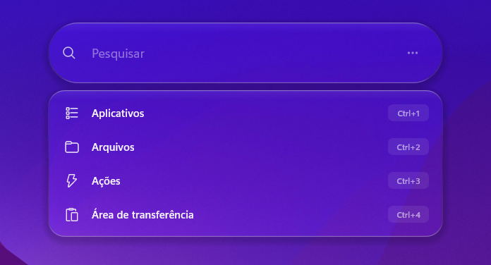 | 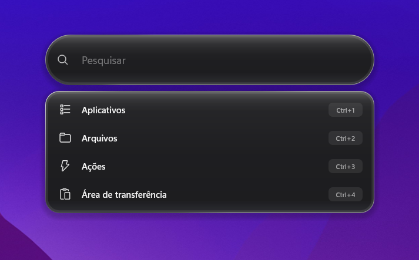 | 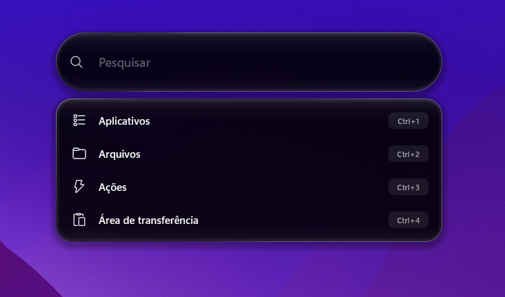 |

### Flutuante
| Vidro transparente | Claro | Gradiente Siri |
|---|---|---|
| 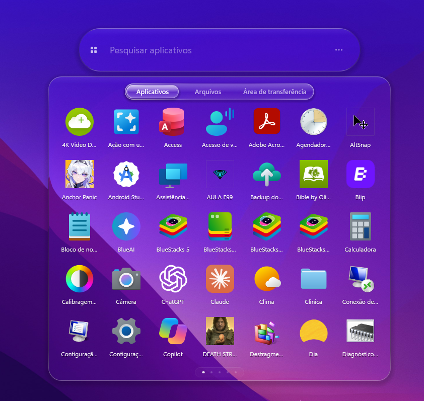 | 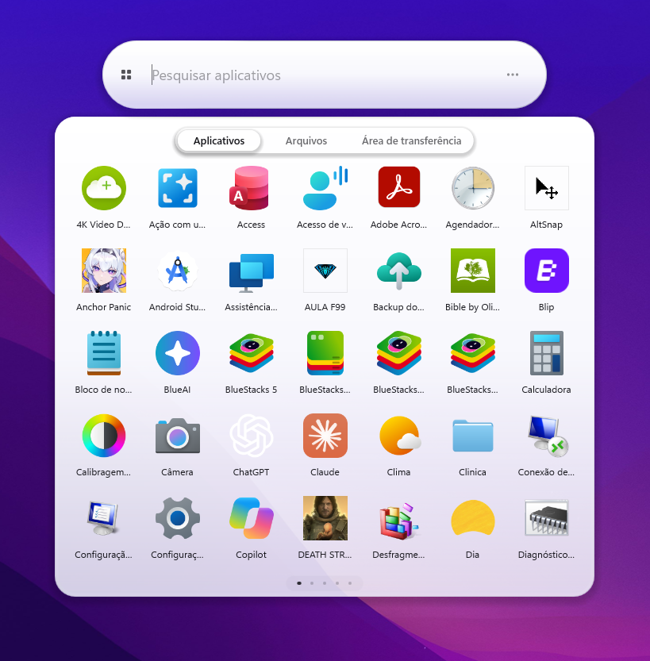 | 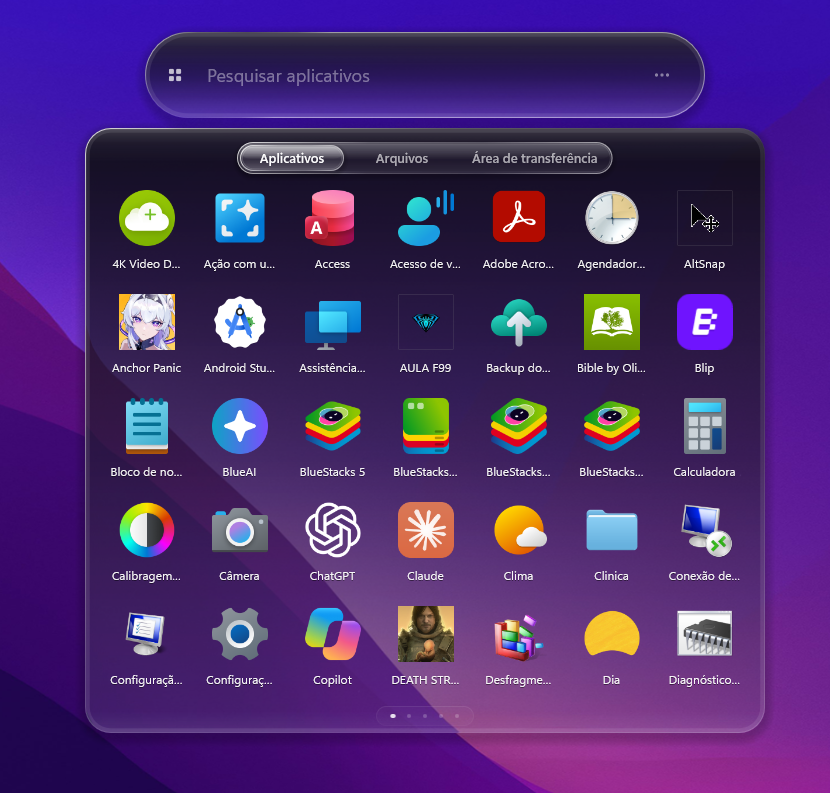 |

| Escuro | OLED |
|---|---|
| 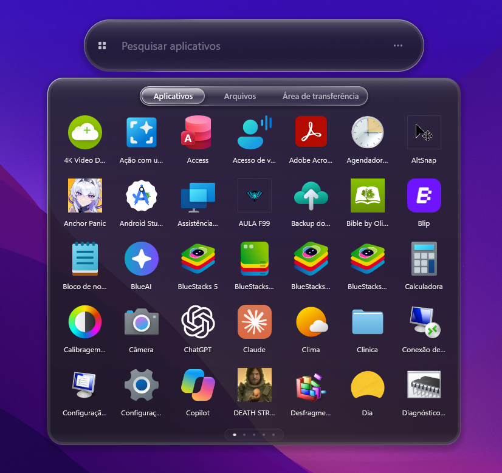 | 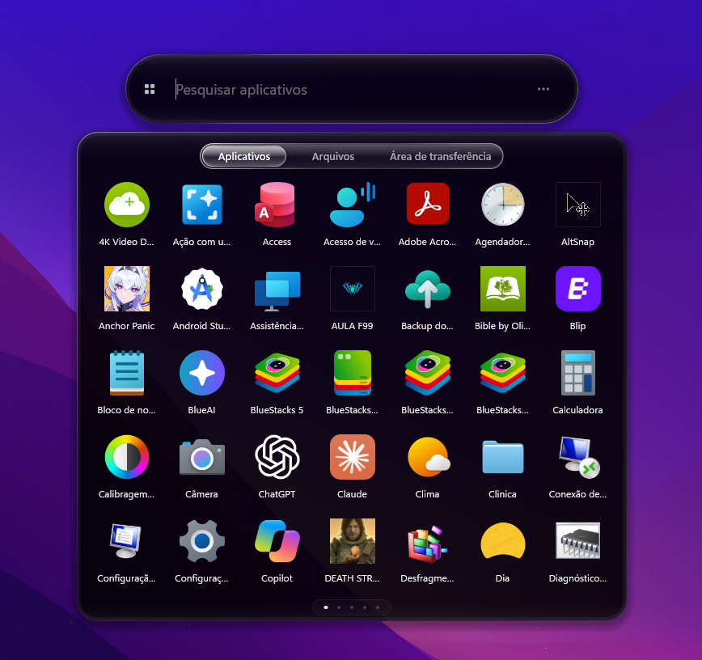 |

### Janela
| Vidro transparente | Claro | Gradiente Siri |
|---|---|---|
| 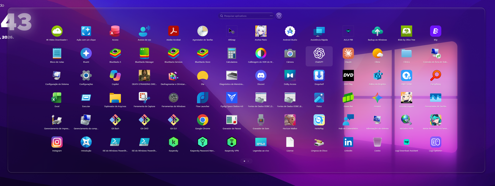 | 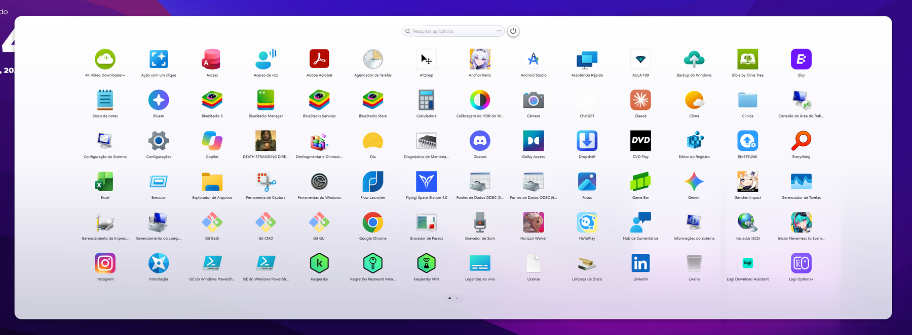 | 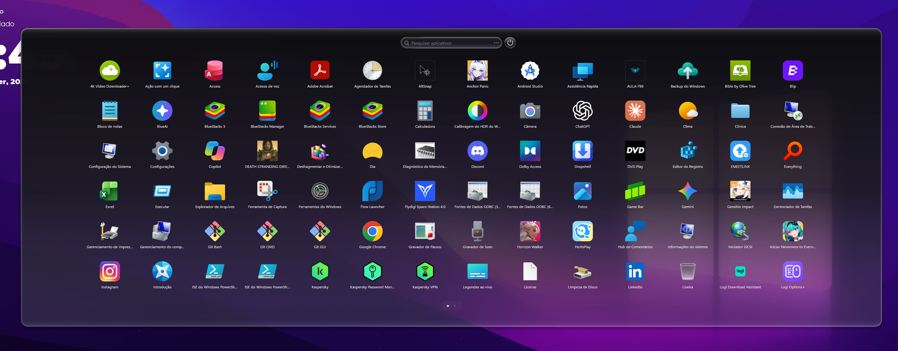 |

| Escuro | OLED |
|---|---|
| 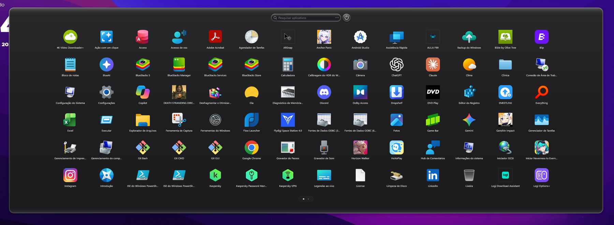 | 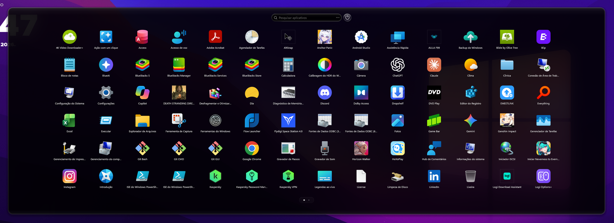 |

### Tela cheia
| Vidro transparente | Claro | Gradiente Siri |
|---|---|---|
| 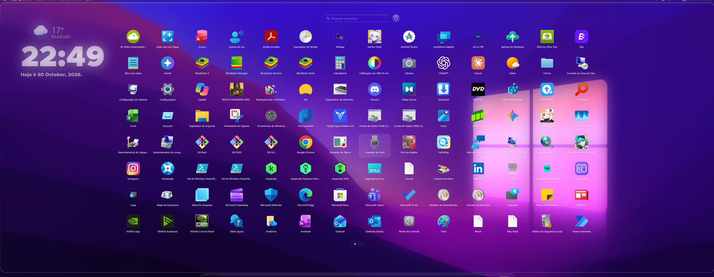 | 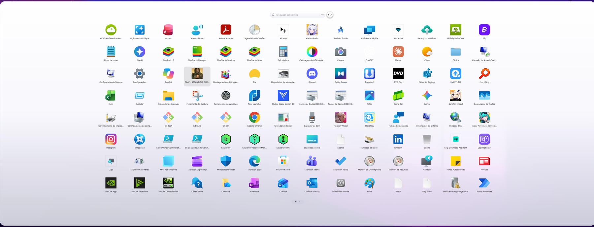 | 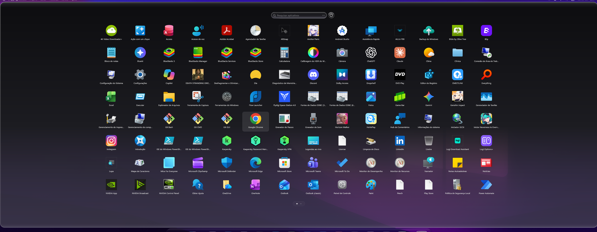 |

| Escuro | OLED |
|---|---|
| 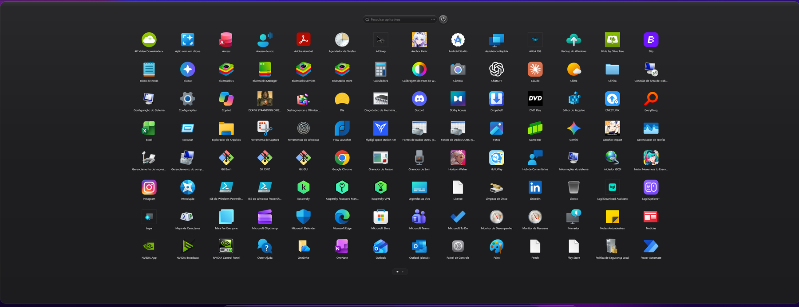 | 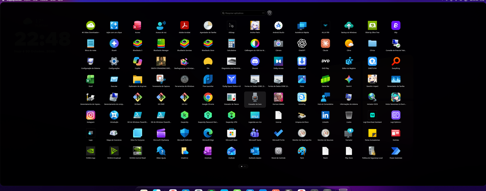 |

### Em ação
| Painel de configurações | Movendo a barra |
|---|---|
|  | 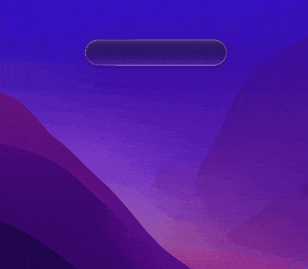 |

| Menus de clique direito e abas | Opções de energia |
|---|---|
| 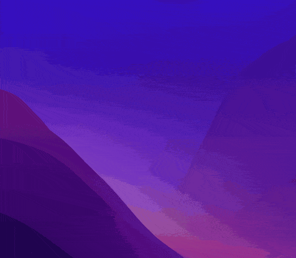 |  |

---

## Modos

### Siri original (padrão)
Uma barra de pesquisa no estilo do macOS 27.

- **Menu de categorias**: passe o mouse sobre a barra (ou clique nela) e desce um menu com **Aplicativos**, **Arquivos**, **Ações** e **Área de transferência**, cada um com seu ícone e seu atalho de teclado (padrão **Ctrl+1 … Ctrl+4**, configurável).
- **Pesquisa geral**: digite direto em "Pesquisar" e uma lista mostra **Aplicativos**, **Ações**, **Pastas** e **Documentos e arquivos** juntos, cada grupo com seu título (os melhores resultados e os apps mais usados primeiro). Os apps aparecem na hora; pastas e arquivos chegam um instante depois, embaixo deles, para nada mudar de lugar quando você vai clicar. **Mostrar todos** ao lado de um título abre aquela categoria com o que você digitou; **Enter** abre o primeiro resultado. A área de transferência nunca entra. Apagar o texto volta à barra "Pesquisar" simples. Dá para desligar (*Pesquisa → Digitar em Pesquisar procura em tudo*): aí digitar vai para Aplicativos.
- **Calculadora**: digite uma conta como *2+2*, *15% * 80* ou *(3+4)^2* e o resultado aparece primeiro, em lista; **Enter** copia. Datas e telefones como *2024-11-04* ou *555-1234* ficam de fora (digite *5 - 3* com espaços, ou comece com **=** ou **calc**, como em *=5-3*, para sempre calcular), e a vírgula ou o ponto decimal seguem a região do Windows. Dá para desligar (*Pesquisa → Calculadora*).
- Escolher uma categoria faz o ícone e o nome dela deslizarem do menu para a barra, e a pesquisa passa a valer só dentro dela.
- **Voltar**: passe o mouse no ícone da categoria na barra e ele vira uma seta de voltar. Clique, ou aperte **Esc**, para voltar a "Pesquisar" com a lupa e escolher outra categoria.
- **Abas de apps**:
  - **Todos** vem primeiro e mostra todos os apps.
  - Depois as categorias automáticas: Utilitários, Produtividade, Entretenimento, Social, Criatividade, Leitura e Outros.
  - Depois até **6 abas suas**, por exemplo "Jogos".
- **Primeira linha**: apps abertos ou instalados por último, ou os mais usados (configurável), separados do resto por uma linha fina.
- **Ações**: Bloquear, Suspender, Reiniciar, Desligar, Sair, Configurações, Gerenciador de Tarefas, Explorador de Arquivos, Painel de Controle, Captura de tela e Esvaziar Lixeira. Desligar funciona como o do próprio Windows (inicialização rápida quando ligada) e avisa antes de desconectar outros usuários ainda conectados.

### Flutuante
A barra surge de um círculo animado, a **onda Siri** ou um brilho suave, com zoom e um quique ajustável. Clicar ou digitar faz o painel de resultados descer. Ao fechar, a barra é "sugada" de volta para a bolha. Passe o mouse no ícone da categoria no começo da barra e ele vira uma seta de voltar, como no Siri original: um clique limpa a pesquisa, volta a Aplicativos e fecha o painel de resultados.

### Janela e Tela cheia
A grade clássica do Launchpad com páginas ou rolagem vertical, pastas e um botão de energia. As páginas sempre deslizam dentro do vidro. A Tela cheia respeita a área de trabalho e o espaço reservado por docks.

---

## Gerenciando as abas de apps (Siri original)

| O quê | Como |
|---|---|
| Criar uma aba | Clique direito num app → **Nova aba com este aplicativo**, ou clique direito na faixa de abas / numa área vazia → **Nova aba**. Digite o nome e aperte **Enter** |
| Adicionar apps | Dentro de uma aba, clique direito → **Adicionar aplicativo**. Um seletor mostra todos os apps: **segure** o primeiro, depois um clique simples seleciona ou tira os outros (os selecionados tremem); **Concluído** salva |
| Tirar um app | Dentro de uma aba, clique direito no app → **Remover da aba** |
| Renomear ou excluir | Clique direito na aba → **Renomear aba** / **Excluir aba** |
| Abas prontas | Também podem ser editadas (adicionar ou tirar apps) e excluídas. **Restaurar abas padrão** traz de volta |
| Andar pelas abas | **Tab / Shift+Tab**, ou clique e arraste a faixa para o lado (a roda do mouse também funciona) |

---

## Arquivos
- **Indexador**: Everything (por IPC, sem DLL), Windows Search ou varredura direta. O padrão, Automático, usa o primeiro disponível.
- Com a pesquisa vazia, aparecem suas **pesquisas recentes**, com um botão para limpar. O histórico pode ser desligado.
- Os resultados mostram a **pasta** de cada arquivo embaixo do nome, em lista ou como ícones.
- O número máximo de resultados é configurável.

## Área de transferência
- Guarda os textos que você copia enquanto o mod roda (só na memória, nunca salvos). O número de itens e por quanto tempo uma cópia fica (de 15 minutos a 7 dias, ou até o Windows reiniciar) são configuráveis.
- A categoria só aparece quando há algo nela. Cada item tem um **×** para remover, e o clique direito oferece **Limpar área de transferência**, que apaga o histórico e a área de transferência do Windows.
- **Senhas ficam de fora**: itens que gerenciadores de senhas e navegadores marcam como secretos são ignorados, como no histórico do próprio Windows (Win+V).
- Mostrada em **lista**: a primeira linha de cada texto, com uma prévia do resto (ou o tamanho) embaixo.
- Clique num item para copiá-lo de novo. Desligar a categoria também para o monitoramento e apaga o histórico.

## Apps e ícones
- **Pesquise** apps digitando.
- **Pastas** (Janela e Tela cheia): arraste apps juntos, renomeie, desfaça. Os modos Siri listam os apps de todas as pastas juntos.
- **Seleção múltipla** com ícones tremendo, **fixar na barra de tarefas** (também arrastando o ícone até ela), **criar atalho na área de trabalho** (clique direito num app; também para vários apps selecionados de uma vez), **desinstalar**.
- **Ícones personalizados**: coloque suas imagens de ícones numa pasta (por exemplo, um pacote de ícones baixado) e clique direito num app → **Alterar ícone...** Na primeira vez, o menu pede essa pasta (dá para trocar depois em *Apps e ícones → Pasta da galeria de ícones*). As imagens da pasta (PNG, JPG, JPEG, BMP, ICO, GIF ou WebP, subpastas incluídas) aparecem numa grade; digite para buscar pelo nome, ou use os pontos de cor para ver uma cor só ou colocar em ordem de arco-íris. Imagens novas na pasta aparecem na próxima vez que ela abrir. O novo ícone é lembrado depois de reiniciar; **Redefinir ícone** volta o original. Funciona em todos os modos, inclusive em apps dentro de pastas.
- Tamanho dos ícones, número de colunas e direção da rolagem são configuráveis.

## Painel de configurações
- Clique no botão **⋯** no fim da barra (em todos os modos). Uma janela no estilo dos Ajustes do Sistema do macOS nasce da barra: as seções à esquerda, com um campo de pesquisa no topo, e as configurações da seção escolhida à direita. Toda mudança vale na hora.
- Seções: **Geral**, **Aparência**, **Tema personalizado**, **Pesquisa** (pesquisa geral, Arquivos e Área de transferência), **Barra Siri**, **Tamanho dos resultados**, **Janela e Tela cheia**, **Animações**, **Atalhos de teclado**, **Apps e ícones**, **Desempenho** e **Backup e padrões**. Cada configuração tem uma linha curta dizendo o que faz, e as que o modo escolhido não usa ficam apagadas, com uma nota.
- O que você muda ali fica por cima das configurações do Windhawk, e uma mudança feita depois no Windhawk volta a valer.
- **Padrão do tema** (Aparência) traz de volta o visual próprio do tema escolhido. **Restaurar todos os padrões** volta todas as configurações ao que o mod traz e a barra ao centro; pastas, abas e ícones personalizados ficam.
- **Fazer backup** salva tudo num arquivo `.siribackup`: todas as configurações (inclusive a pasta da galeria de ícones), pastas, abas, histórico de pesquisas, o lugar da barra e os ícones personalizados, com as imagens dentro do arquivo. **Restaurar backup** traz tudo de volta, também depois de desinstalar o mod (o que apaga os dados guardados) ou em outro PC.
- **Concluído** (ou **Esc**) fecha: a janela se apaga no lugar, como uma TV antiga (CRT), e o menu fecha; um modo ou tamanho de barra novo aparece na próxima vez que abrir. No modo de desempenho Leve, a janela abre sem o conteúdo entrar parte por parte.

## Movendo a barra (Flutuante e Siri original)
- Segure a barra um instante e arraste para qualquer lugar, em qualquer monitor. O lugar é lembrado. Embaixo na tela, os resultados e os menus abrem acima dela.
- Clique direito na barra → **Voltar a barra para o centro** (aparece depois que ela foi movida).

---

## Personalização

Todas as opções estão no painel **⋯** (em sete idiomas) e na aba **Configurações** do mod no Windhawk (inglês e português).

| Bloco | Opções |
|---|---|
| ① Modo | Siri original (padrão), Flutuante, Janela, Tela cheia |
| ② Tema | Vidro transparente, Claro, Escuro, OLED, Siri (gradiente do macOS 27), Personalizado |
| Idioma | Automático (Windows) ou English, Português, Español, Français, Deutsch, Italiano, 中文（简体） |
| Desempenho | **Leve (mais rápido)** desliga o vidro líquido, o desfoque atrás dos menus e as sombras e limita a 60 quadros por segundo, para notebooks e PCs mais lentos; um limite de quadros (automático, 120, 60 ou 30); e *Desenhar com*: a placa de vídeo (padrão) ou o processador (experimental, para notebooks com duas placas de vídeo) |
| ③ Aparência | Botão Padrão do tema, transparência do vidro (cada tema guarda a sua; Claro e OLED começam sólidos), arredondamento dos cantos, desfoque do fundo (0 = sem desfoque), desfoque atrás dos menus de clique direito, cor do texto (automática: no vidro transparente, preto sobre fundos claros; ou branco ou preto), estilo do vidro transparente (fosco, ou líquido experimental no Flutuante e no Siri original, com a força da refração e um modo ao vivo opcional), efeito vidro no Claro/Escuro/OLED |
| ④ Tema personalizado | Cor, opacidade, degradê escuro → claro, espessura, cor e opacidade da borda |
| ⑤ Janela e Tela cheia | Tamanho da janela, estilo da pesquisa (barra no topo ou caixa centralizada), botão de energia e sua posição, animações de abertura e fechamento (surgir, esmaecer, subir da/descer até a barra de tarefas, CRT), velocidade das animações, desfoque atrás das pastas abertas |
| ⑥ Flutuante e Siri original | Tamanho da barra (96 px de altura por padrão), largura e linhas da caixa de resultados de cada categoria (Arquivos e Área de transferência da largura da barra por padrão), animação do círculo (onda Siri, brilho suave, nenhuma), zoom do círculo, quique do círculo e da caixa de resultados, duração da abertura e do fechamento, velocidade das animações, pesquisa geral ao digitar, opções de energia ao digitar, botão de energia flutuante (desligado por padrão) e seu lado (esquerda ou direita da barra), primeira linha (recentes, mais usados, desligada), atalhos das categorias do Siri original para Aplicativos, Arquivos, Ações e Área de transferência (padrão **Ctrl+1**, **Ctrl+2**, **Ctrl+3**, **Ctrl+4**; qualquer combinação começando com Ctrl, por exemplo Ctrl+Shift+F ou Ctrl+F2), e se também funcionam com o menu fechado (desligado por padrão) |
| ⑦ Abertura | Abrir com a tecla Windows e/ou o botão Iniciar |
| ⑧ Apps e ícones | Tamanho dos ícones, colunas, direção da rolagem, tremer, arrastar até a barra de tarefas para fixar, pasta da galeria de ícones |
| ⑨ Arquivos | Liga/desliga, histórico de pesquisas, lista ou ícones, indexador, máximo de resultados |
| ⑩ Área de transferência | Liga/desliga, número de itens guardados, por quanto tempo uma cópia fica |

---

## Teclado e mouse

| Tecla / ação | O que faz |
|---|---|
| **Win** / botão Iniciar | Abre ou fecha |
| Digitar | Pesquisa (no Siri original, digitar direto procura apps, ações, pastas e arquivos juntos) |
| **Ctrl+1 / 2 / 3 / 4** | Siri original: vai para Aplicativos / Arquivos / Ações / Área de transferência (configurável). Com *Também com o menu fechado* ligado (desligado por padrão), abrem o menu de qualquer programa, e os outros programas deixam de receber essas teclas |
| **Tab / Shift+Tab** | Siri original: próxima/anterior aba de apps, ou anda pelos resultados em Arquivos, Área de transferência e Ações |
| Setas + **Enter** | Anda pelos resultados / abre |
| Outros **Ctrl+números** | Abrem o resultado correspondente (nunca uma ação como Desligar) |
| **Esc** | Fecha menus, depois limpa a pesquisa, volta às categorias e por fim fecha |
| Clique direito na barra de pesquisa | Recortar, Copiar, Colar, Selecionar tudo, Apagar tudo |
| Segurar um app | Seleciona; depois um clique simples seleciona ou tira mais apps (Janela/Tela cheia: clique direito → **Nova pasta com N itens** coloca numa pasta; Siri original: dentro do seletor de apps) |

---

## Requisitos
- Windows 11 (x64)
- [Windhawk](https://windhawk.net)
- O desfoque ao vivo precisa dos **Efeitos de transparência** ligados no Windows (*Configurações → Personalização → Cores*). Sem eles, é usada uma imagem parada desfocada.
- Opcional: [Everything](https://www.voidtools.com) para pesquisa de arquivos instantânea (rode normalmente, não como administrador)

## Privacidade e arquivos
- O mod nunca acessa a internet.
- Os arquivos dele (ícones restaurados de um backup, as cores encontradas nas imagens da galeria) ficam na pasta de armazenamento do mod, que o Windhawk apaga junto com o mod. As imagens da galeria só são lidas da pasta que você escolhe; backups só são gravados onde você escolhe. **Criar atalho na área de trabalho** só cria um atalho quando você pede, e nunca substitui um arquivo que já esteja lá.
- O histórico da área de transferência fica só na memória e nunca é gravado em disco.

## Compatibilidade
- **Atalhos das categorias de qualquer programa** (desligado por padrão): com *Atalhos → Também com o menu fechado* ligado, Ctrl+1 … Ctrl+4 viram teclas de atalho do sistema, e os outros programas deixam de recebê-las (por exemplo, o Ctrl+1 do navegador para a primeira aba). Deixe desligado, ou escolha outras combinações, se precisar dessas teclas em outro lugar.
- **Fullscreen Start** (`fullscreen-start`): não ative os dois. Cada um substitui o menu Iniciar pelo mesmo gancho sem chamar o original, então só um deles receberia a tecla Windows.
- **Spotlight Launcher**: ele adiciona uma barra de pesquisa separada no Alt+Espaço e não mexe no menu Iniciar. Este mod substitui o próprio menu Iniciar (tecla Windows e botão Iniciar) e adiciona abas de apps, pastas, arquivos, histórico da área de transferência e ações. Dá para usar os dois juntos.

---

## Apoie o projeto
Se você gosta do Siri Plus Launchpad, pode apoiar o desenvolvimento com uma doação via Pix:

**[Doar com LivePix (Pix)](https://livepix.gg/kurokobr)**

---

## Autor
Desenvolvido e mantido por **Thiago Silva** ([github.com/brideinflame-rgb](https://github.com/brideinflame-rgb)).

## Licença
Copyright (c) 2026 Thiago Silva. Licenciado sob a **GNU General Public License v3.0**.
